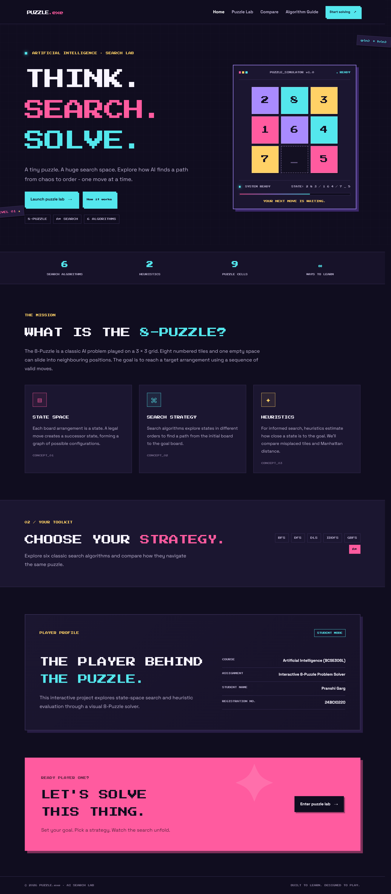
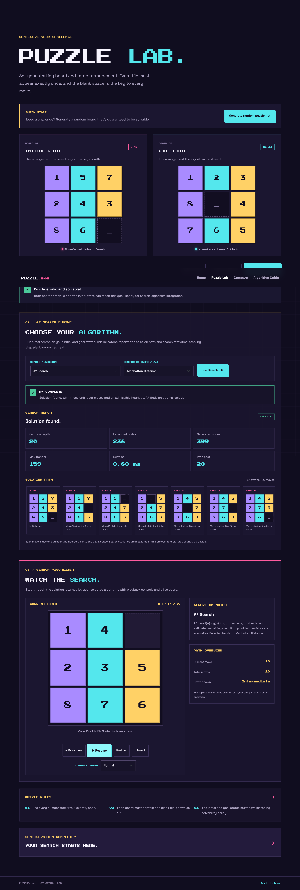
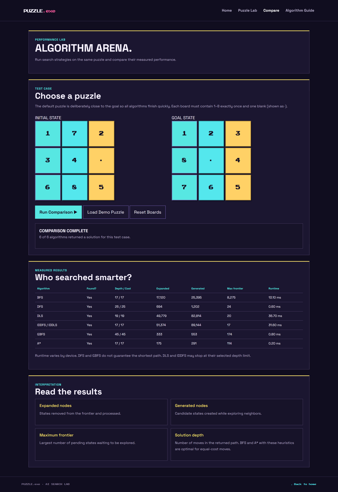
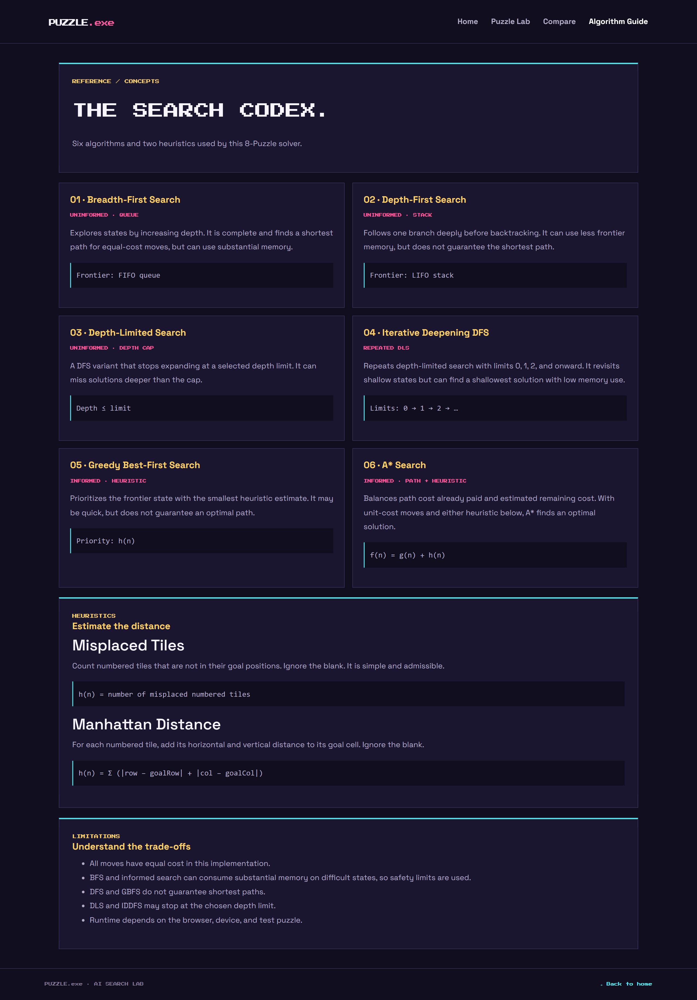

# Interactive 8-Puzzle Problem Solver Using AI Search Algorithms

## Project Overview

The Interactive 8-Puzzle Problem Solver is a web-based application that demonstrates how Artificial Intelligence search algorithms solve the 8-puzzle problem. The puzzle consists of eight numbered tiles and one empty space arranged in a 3 × 3 grid. The objective is to transform an initial state into a specified goal state by moving tiles into the empty space.

The application provides an interactive puzzle interface, algorithm selection, solution playback, and performance comparison to help users understand how different search strategies work.

## Objectives

- Understand state-space search through an interactive puzzle.
- Implement and demonstrate multiple AI search algorithms.
- Visualize the solution path from the initial state to the goal state.
- Compare algorithms using search statistics and execution time.
- Explain heuristic search using misplaced tiles and Manhattan distance.

## Algorithms

The project covers the following algorithms:

1. **Breadth-First Search (BFS):** Explores states level by level.
2. **Depth-First Search (DFS):** Explores one branch deeply before backtracking.
3. **Depth-Limited Search (DLS):** DFS with a specified depth limit.
4. **Iterative Deepening Depth-First Search (IDDFS):** Repeats depth-limited search with increasing limits.
5. **Greedy Best-First Search (GBFS):** Prioritizes states based on a heuristic estimate.
6. **A* Search:** Uses path cost and heuristic estimate to prioritize states.

## Heuristics

- **Misplaced Tiles:** Counts the numbered tiles that are not in their goal positions.
- **Manhattan Distance:** Adds the horizontal and vertical distances of each numbered tile from its goal position.

These heuristics are used by Greedy Best-First Search and A* Search.
# Interactive 8-Puzzle Problem Solver Using AI Search Algorithms

## Project Overview

The Interactive 8-Puzzle Problem Solver is a web-based application that demonstrates how Artificial Intelligence search algorithms solve the 8-puzzle problem. The puzzle consists of eight numbered tiles and one empty space arranged in a 3 × 3 grid. The objective is to transform an initial state into a specified goal state by moving tiles into the empty space.

The application provides an interactive puzzle interface, algorithm selection, solution playback, and performance comparison to help users understand how different search strategies work.

## Objectives

- Understand state-space search through an interactive puzzle.
- Implement and demonstrate multiple AI search algorithms.
- Visualize the solution path from the initial state to the goal state.
- Compare algorithms using search statistics and execution time.
- Explain heuristic search using misplaced tiles and Manhattan distance.

## Algorithms

The project covers the following algorithms:

1. **Breadth-First Search (BFS):** Explores states level by level.
2. **Depth-First Search (DFS):** Explores one branch deeply before backtracking.
3. **Depth-Limited Search (DLS):** DFS with a specified depth limit.
4. **Iterative Deepening Depth-First Search (IDDFS):** Repeats depth-limited search with increasing limits.
5. **Greedy Best-First Search (GBFS):** Prioritizes states based on a heuristic estimate.
6. **A* Search:** Uses path cost and heuristic estimate to prioritize states.

## Heuristics

- **Misplaced Tiles:** Counts the numbered tiles that are not in their goal positions.
- **Manhattan Distance:** Adds the horizontal and vertical distances of each numbered tile from its goal position.

These heuristics are used by Greedy Best-First Search and A* Search.

## Technologies Used

## Technologies Used

- HTML5
- CSS3
- JavaScript (ES6)
- Bootstrap or other styling utilities used in the project
- Git and GitHub
- GitHub Pages for deployment

## Website Pages

- **Home:** Project introduction and navigation.
- **Puzzle Lab:** Puzzle configuration, algorithm selection, and solution playback.
- **Algorithm Comparison:** Comparison of search algorithms using available performance statistics.
- **Algorithm Guide:** Explanations of algorithms and heuristics.

## How to Run

1. Clone or download this repository.
2. Open the project folder.
3. Open `index.html` in a browser, or use the VS Code Live Server extension.
4. Navigate to the Puzzle Lab to configure and solve a puzzle.

## How to Use

1. Select or enter the initial and goal states.
2. Choose an algorithm and, where applicable, a heuristic.
3. Start the search.
4. Use the available playback controls to inspect the solution.
5. Visit the comparison page to review the reported algorithm statistics.

## Performance Metrics

The comparison page may report metrics such as:

- Whether a solution was found
- Solution depth
- Expanded nodes
- Generated nodes
- Maximum frontier size
- Runtime

The exact values depend on the puzzle configuration and algorithm implementation.

## Limitations

Search performance depends on the selected algorithm, puzzle configuration, and search limits. Depth-first and depth-limited methods do not guarantee the shortest solution in general. The completeness and optimality of each method depend on its implementation and configuration.

## Author

- **Name:** Pranshi Garg
- **Registration Number:** 24BCI0220
- **Course:** Artificial Intelligence (BCSE306L)
- JavaScript (ES6)
- Bootstrap or other styling utilities used in the project
- Git and GitHub
- GitHub Pages for deployment

## Website Pages

- **Home:** Project introduction and navigation.
- **Puzzle Lab:** Puzzle configuration, algorithm selection, and solution playback.
- **Algorithm Comparison:** Comparison of search algorithms using available performance statistics.
- **Algorithm Guide:** Explanations of algorithms and heuristics.

## How to Run

1. Clone or download this repository.
2. Open the project folder.
3. Open `index.html` in a browser, or use the VS Code Live Server extension.
4. Navigate to the Puzzle Lab to configure and solve a puzzle.

## How to Use

1. Select or enter the initial and goal states.
2. Choose an algorithm and, where applicable, a heuristic.
3. Start the search.
4. Use the available playback controls to inspect the solution.
5. Visit the comparison page to review the reported algorithm statistics.

## Performance Metrics

The comparison page may report metrics such as:

- Whether a solution was found
- Solution depth
- Expanded nodes
- Generated nodes
- Maximum frontier size
- Runtime

The exact values depend on the puzzle configuration and algorithm implementation.

## Limitations

Search performance depends on the selected algorithm, puzzle configuration, and search limits. Depth-first and depth-limited methods do not guarantee the shortest solution in general. The completeness and optimality of each method depend on its implementation and configuration.

## Author

- **Name:** Pranshi Garg
- **Registration Number:** 24BCI0220
- **Course:** Artificial Intelligence (BCSE306L)

## Project Links

- **Live Website:** https://pranshigarg01.github.io/AI-8Puzzle/
- **GitHub Repository:** https://github.com/PranshiGarg01/AI-8Puzzle

## Screenshots

### 1. Homepage
The homepage introduces the project and provides navigation to the main features.

### 2. Puzzle Lab & Solution Playback
The puzzle-solving interface allows users to configure the puzzle and select a search algorithm.
The board displays the solution progressing toward the goal state using the available playback controls.

### 3. Algorithm Comparison
The comparison page displays the performance metrics produced by the implemented search algorithms.

### 4. Algorithm Guide
The guide explains the implemented search strategies and the heuristic functions.

